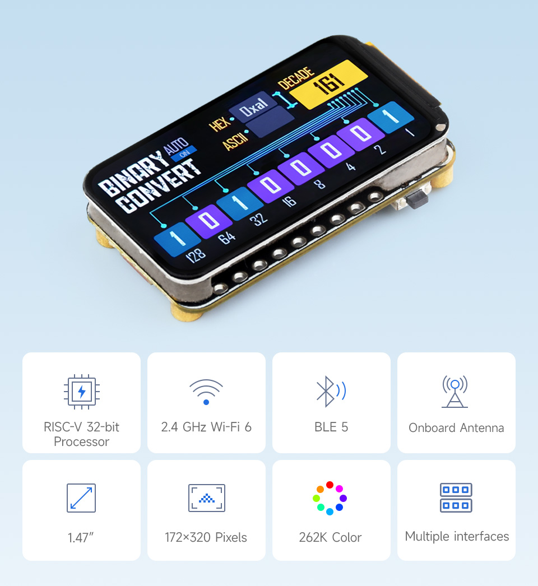
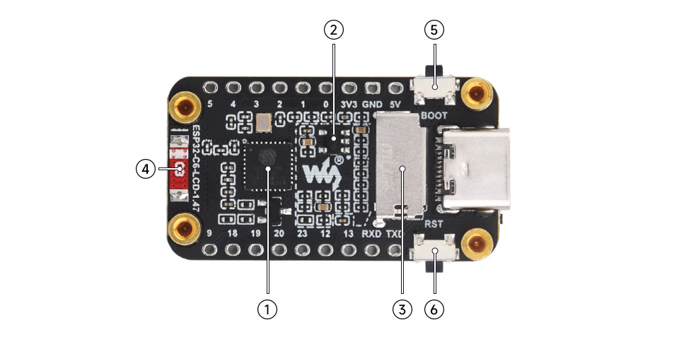
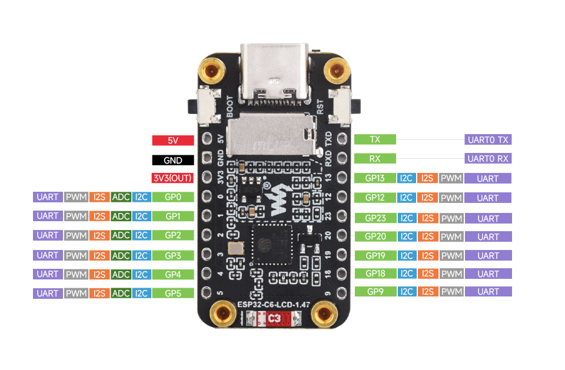
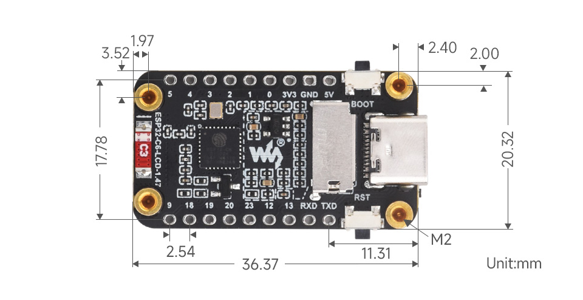
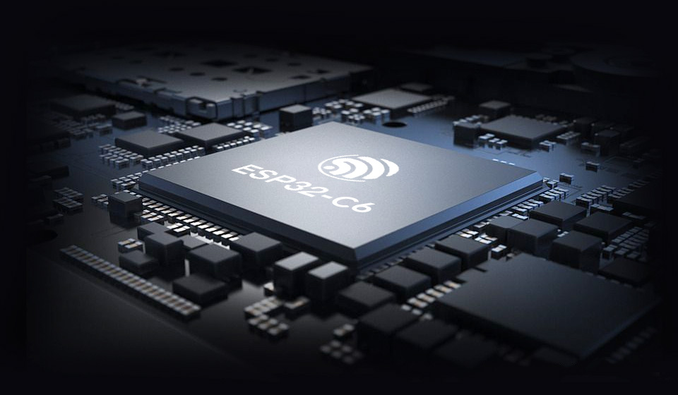
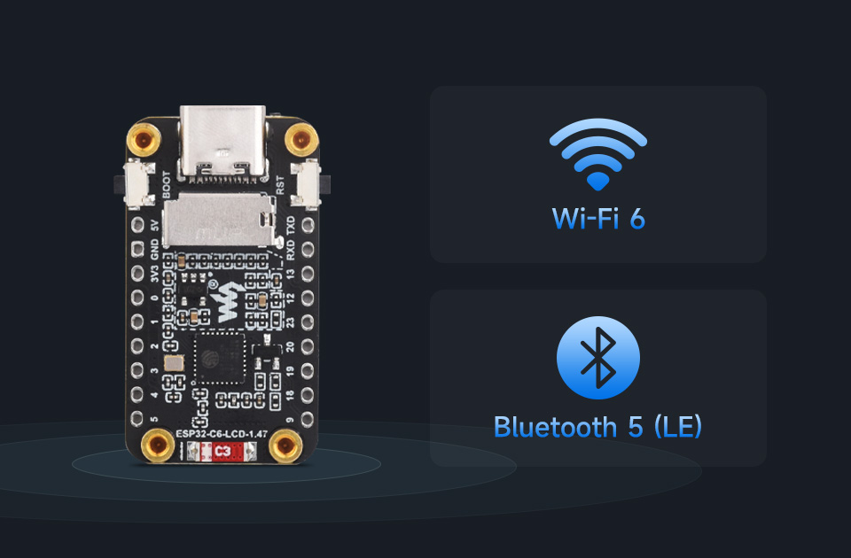

# Waveshare ESP32-C6-LCD-1.47 — Fiche matériel

- Wiki officiel : http://www.waveshare.com/wiki/ESP32-C6-LCD-1.47
- Infos relevées le 2026-10-17 (fiche produit + wiki Waveshare).

## Caractéristiques générales

| Élément | Valeur |
|---|---|
| SoC | **ESP32-C6FH4** |
| CPU HP | RISC-V 32 bits, mono-cœur, jusqu'à 160 MHz |
| CPU LP | RISC-V 32 bits basse consommation, jusqu'à 20 MHz |
| Mémoire | 320 Ko ROM, 512 Ko SRAM HP, 16 Ko SRAM LP, **4 Mo Flash** (intégrée au SoC) |
| PSRAM | **Aucune** → buffers LVGL partiels obligatoires |
| Radio | Wi-Fi 6 2,4 GHz (802.11 b/g/n/ax), Bluetooth 5 LE, IEEE 802.15.4 (Zigbee / Thread) |
| Antenne | Céramique intégrée (PCB) |
| Écran | 1,47", IPS, **172 × 320**, 262K couleurs, contrôleur **ST7789**, SPI |
| Stockage externe | Slot carte TF (microSD), en SPI |
| LED | LED RGB adressable sur GPIO8 (type WS2812 d'après les démos — à confirmer sur le schéma) |
| USB | USB-C, USB Serial/JTAG natif de l'ESP32-C6 (flash + console) |
| Régulateur | ME6217C33M5G, LDO 3,3 V, 800 mA max |
| Boutons | BOOT (GPIO9), RESET |
| Divers | Panneau sandwich acrylique transparent (effet lumineux de la LED) |

## Composants repérés

1. ESP32-C6FH4
2. ME6217C33M5G — régulateur LDO 800 mA
3. Emplacement carte TF
4. Antenne céramique intégrée
5. Bouton BOOT
6. Bouton RESET

## Affectation des GPIO internes (confirmée par le wiki)

### Écran LCD (ST7789, SPI)

| Signal | GPIO |
|---|---|
| MOSI | 6 |
| SCLK | 7 |
| LCD_CS | 14 |
| LCD_DC | 15 |
| LCD_RST | 21 |
| LCD_BL (rétroéclairage, PWM) | 22 |

- Le ST7789 gère 240 × 320 ; la dalle fait 172 de large → **décalage X de 34 px** (non indiqué sur le wiki, valeur utilisée dans les démos Waveshare — à vérifier au premier test).

### Carte TF (bus SPI partagé avec l'écran)

| Signal | GPIO |
|---|---|
| MISO | 5 |
| MOSI | 6 (partagé LCD) |
| SCLK | 7 (partagé LCD) |
| SD_CS | 4 |
| SD_D1 / SD_D2 | non connectés |

⚠️ **GP4 et GP5 sont aussi sortis sur le connecteur** : ne pas les utiliser si la carte SD sert.

### Autres

| Fonction | GPIO |
|---|---|
| LED RGB | 8 |
| Bouton BOOT | 9 (strapping — utilisable comme bouton après démarrage) |
| UART0 TX / RX | TXD / RXD du connecteur |

## Brochage du connecteur

| Côté gauche | Fonctions | Côté droit | Fonctions |
|---|---|---|---|
| 5V | Alim | TXD | UART0 TX |
| GND | Masse | RXD | UART0 RX |
| 3V3 | Sortie 3,3 V | GP13 | I2C, I2S, PWM, UART |
| GP0 | ADC, I2C, I2S, PWM, UART | GP12 | I2C, I2S, PWM, UART |
| GP1 | ADC, I2C, I2S, PWM, UART | GP23 | I2C, I2S, PWM, UART |
| GP2 | ADC, I2C, I2S, PWM, UART | GP20 | I2C, I2S, PWM, UART |
| GP3 | ADC, I2C, I2S, PWM, UART | GP19 | I2C, I2S, PWM, UART |
| GP4 | ADC, I2C, I2S, PWM, UART (⚠️ SD_CS) | GP18 | I2C, I2S, PWM, UART |
| GP5 | ADC, I2C, I2S, PWM, UART (⚠️ SD_MISO) | GP9 | I2C, I2S, PWM, UART (⚠️ BOOT) |

- Notes : seuls GP0 à GP5 ont l'ADC. GP12 et GP13 sont les lignes USB D-/D+ du SoC : les utiliser coupe l'USB natif.

## Dimensions mécaniques

- Carte : **36,37 × 20,32 mm**
- Pas des broches : 2,54 mm ; entraxe des deux rangées : 17,78 mm
- Trous de fixation : **M2** (4×)
- Cotes diverses : 3,52 / 1,97 mm (trou gauche), 2,40 / 2,00 mm (trou droit), 11,31 mm (bord droit → 1ʳᵉ broche TXD/5V)

## Logiciel (d'après le wiki)

### Arduino
- Paquet de cartes « esp32 by Espressif Systems » **≥ 3.0.0** (offline fourni : 3.0.2)
- Bibliothèques : **LVGL 8.3.10**, **PNGdec 1.0.2**
- Carte à sélectionner : *ESP32C6 Dev Module* (le wiki indique « ESP32S3 Dev Module », probablement une erreur de copier-coller)
- Activer **USB CDC On Boot** pour avoir la console série sur l'USB-C

### ESP-IDF
- **ESP-IDF ≥ 5.3.1**, via l'extension Espressif IDF de VS Code
- Cible : `esp32c6`

### Démos fournies
| Démo | Framework | Contenu |
|---|---|---|
| LVGL_Arduino | Arduino | Test carte SD, taille flash, scan sans fil, affichage LVGL |
| LCD_Image | Arduino | Diaporama des PNG à la racine de la carte TF (≤ 172×320) |
| ESP32-C6-LCD-1.47-Test | ESP-IDF | Test SD, flash, scan sans fil, charge CPU, LED RGB, LVGL |

Fonctions d'init de la démo IDF : `Wireless_Init()`, `Flash_Searching()`, `RGB_Init()`, `RGB_Example()`, `SD_Init()`, `LCD_Init()`, `BK_Light(50)`, `LVGL_Init()` puis `lv_timer_handler()` toutes les 10 ms.

### Téléchargements (liens sur le wiki)
- Schéma : `ESP32-C6-LCD-1.47_schemetics.pdf`
- Démos + firmware de test : `ESP32-C6-LCD-1.47-Demo.zip` (firmware dans `Firmware/`)
- Modèle 3D : `ESP32-C6-LCD-1.47-3D_Drawing.rar`
- Datasheets : ESP32-C6 (datasheet + manuel de référence technique), LCD 1,47"
- Outil : Espressif Flash Download Tool

## Dépannage

- **Flash impossible / port non détecté** : maintenir BOOT, appuyer sur RESET, relâcher RESET, puis relâcher BOOT (mode téléchargement).
- **Reset en boucle / écran qui scintille** : flash vide ou USB instable → même procédure.
- **« Waiting for download… » après flash IDF** : appuyer sur RESET.
- **Pas de sortie série (Arduino)** : vérifier USB CDC On Boot.
- **Première compilation très lente** : normal.

## Galerie

| | |
|---|---|
|  |  |
